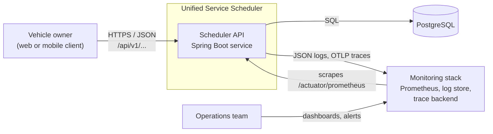
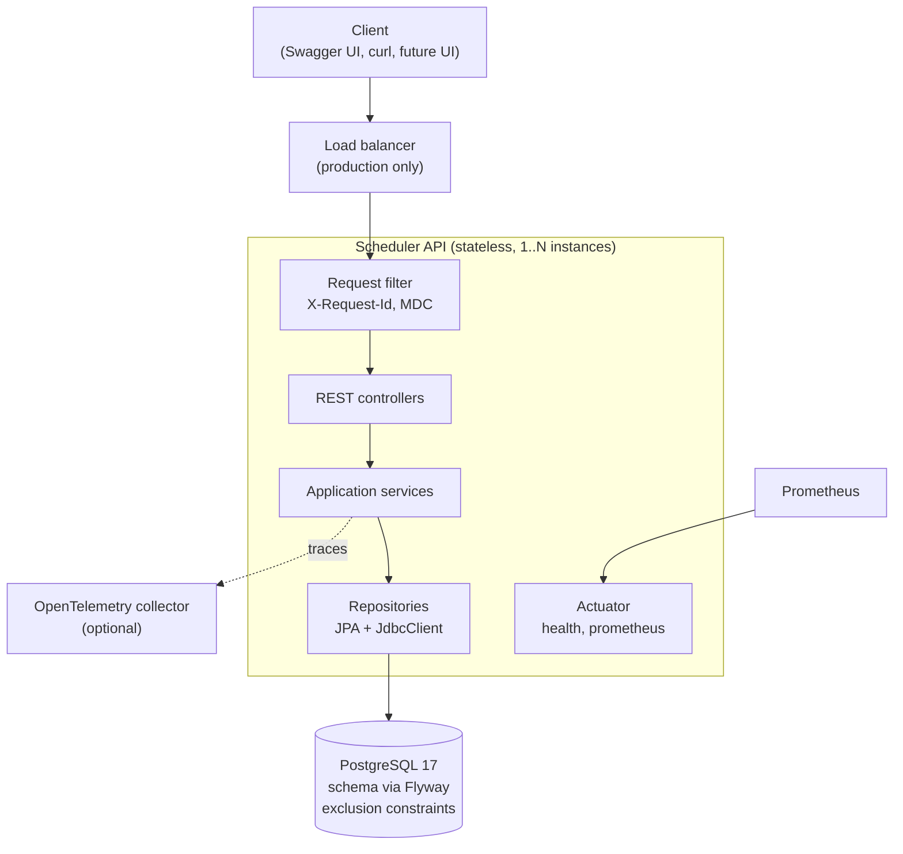
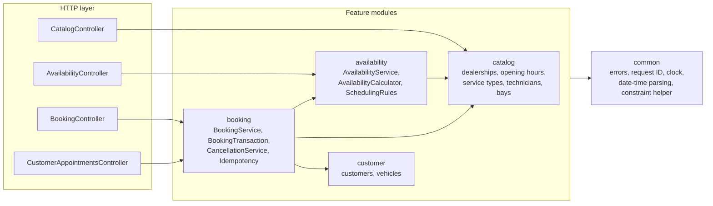
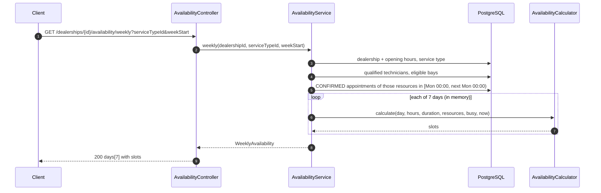
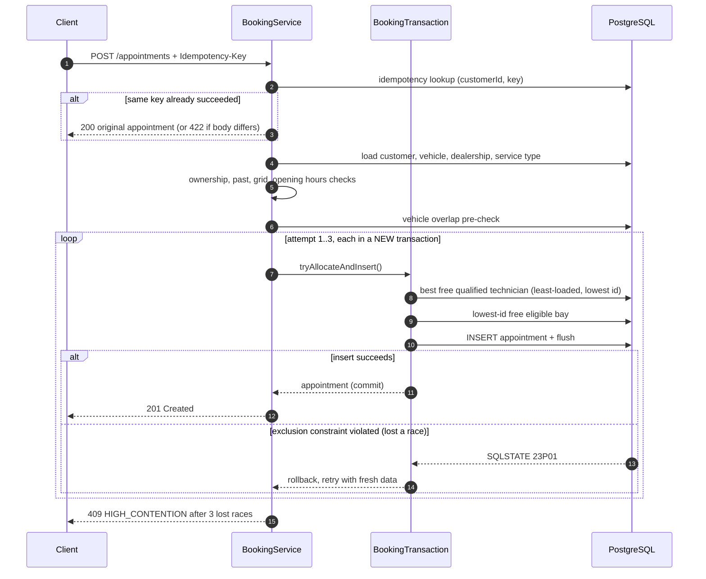

# 02: Architecture

## 1. System context



The MVP has no client application. Swagger UI, a curl demo script, and an `.http` file stand in for it (E-03).

## 2. Containers and deployment



| Environment | How it runs |
|---|---|
| Local / reviewer | `docker compose up --build`: one API container and one PostgreSQL container. The `dev` profile loads the fixture data |
| Tests | `./gradlew build`: the API in-process, PostgreSQL via Testcontainers |
| Production (described, not built) | 2+ API instances behind a load balancer, managed PostgreSQL with a standby replica, Prometheus and an OTLP collector |

## 3. Components

The API is a **modular monolith** (ADR-001): one deployable unit, split into feature modules with strict dependency rules.



| Component | Role |
|---|---|
| `common.web.RequestIdFilter` | Reads or generates `X-Request-Id`, puts it in the logging context (MDC), echoes it in the response |
| `common.error.GlobalExceptionHandler` | Turns every exception into an RFC 7807 problem response with `code` and `requestId`. The only place that maps errors to HTTP statuses |
| `common.time` | Provides the `Clock` bean (Vietnam time) and strict parsing and formatting of local date-times (ADR-003) |
| `catalog` | Read-only reference data: dealerships, opening hours, service types, technicians, bays. Serves US-01 |
| `customer` | Customers and vehicles. Used for existence and ownership checks |
| `availability.SchedulingRules` | Pure rules shared by availability and booking: 15-minute grid, opening-hours fit |
| `availability.AvailabilityCalculator` | Pure function: given one day's opening hours, resources, and busy intervals, returns free slots. No Spring or database code |
| `availability.AvailabilityService` | Loads the data for a day or a week in a fixed number of queries and calls the calculator (US-02, US-09) |
| `booking.BookingService` | Orchestrates a booking: validation order, idempotency replay, the retry loop, metrics and the outcome log. **Not transactional** |
| `booking.BookingTransaction` | One booking attempt in one transaction: pick a technician, pick a bay, insert. Separate bean so `@Transactional` applies (04 §4) |
| `booking.AllocationQueries` | Native SQL (via `JdbcClient`) that selects the best free technician and bay |
| `booking.CancellationService` | Conditional-update cancellation (US-07) |
| `booking.BookingMetrics` | Micrometer counters and timers for booking outcomes (E-02) |
| Flyway migrations | Own the schema, including the exclusion constraints that guarantee correctness |

## 4. Package structure

The coding model must follow this layout exactly.

```text
com.keyloop.scheduler
├── SchedulerApplication.java
├── common
│   ├── error        ErrorCode (enum: code + HTTP status), ApiException, GlobalExceptionHandler
│   ├── web          RequestIdFilter
│   ├── time         ClockConfig, LocalDateTimes (strict parse/format)
│   └── persistence  ConstraintViolations (reads SQLState and constraint name)
├── catalog
│   ├── Dealership, OpeningHours, ServiceType, Technician, ServiceBay   (JPA entities)
│   ├── Skill, BayType                                                 (enums)
│   ├── *Repository                                                    (Spring Data JPA)
│   ├── CatalogService, CatalogController
│   └── dto/                                                           (records)
├── customer
│   ├── Customer, Vehicle, CustomerRepository, VehicleRepository
├── availability
│   ├── SchedulingRules, AvailabilityCalculator, Slot, BusyInterval    (pure, no Spring)
│   ├── AvailabilityService, AvailabilityController
│   └── dto/
└── booking
    ├── Appointment, AppointmentStatus, AppointmentRepository
    ├── AllocationQueries                                              (JdbcClient, native SQL)
    ├── BookingService, BookingTransaction, BookingOutcome
    ├── CancellationService, BookingMetrics, RequestHasher
    ├── BookingController, CustomerAppointmentsController
    └── dto/
```

**Dependency rules** (enforced by an ArchUnit test if time allows):

1. Controllers call services only, never repositories.
2. Module dependencies follow the arrows in §3. `catalog`, `customer`, and `common` depend on no feature module. No cycles.
3. Classes marked *pure* have no Spring annotations, no database access, and no `LocalDateTime.now()` (time is passed in), so they can be unit tested exhaustively.
4. Entities never leave the service layer. Controllers return DTO records.

## 5. Data flow

### Request lifecycle (all endpoints)

1. `RequestIdFilter` sets `X-Request-Id` and the MDC `requestId`.
2. The controller binds and validates the request (Bean Validation, strict date-time parsing). Shape errors become **400**.
3. The service applies business rules in the order given by the stories, using repositories. Business-rule errors are thrown as `ApiException(ErrorCode)`.
4. `GlobalExceptionHandler` maps any exception to a problem response. Unexpected exceptions become **500** with no internal details, and are logged with a stack trace.
5. Micrometer records `http.server.requests` and, for bookings, the booking metrics. The trace span closes.

### Flow 1: Customer picks a time (US-09, US-02)



### Flow 2: Customer books (US-03, US-04, US-05)



Details, including every error branch, are in [04](04-booking-and-concurrency.md).

### Flow 3: Customer cancels (US-07)

The client calls `POST /appointments/{id}/cancel`. `CancellationService` runs one conditional `UPDATE` (status CONFIRMED, start in the future). The row lock serializes concurrent cancels. The freed interval no longer matches the exclusion constraints' `WHERE status = 'CONFIRMED'`, so it is immediately bookable and visible in availability.
