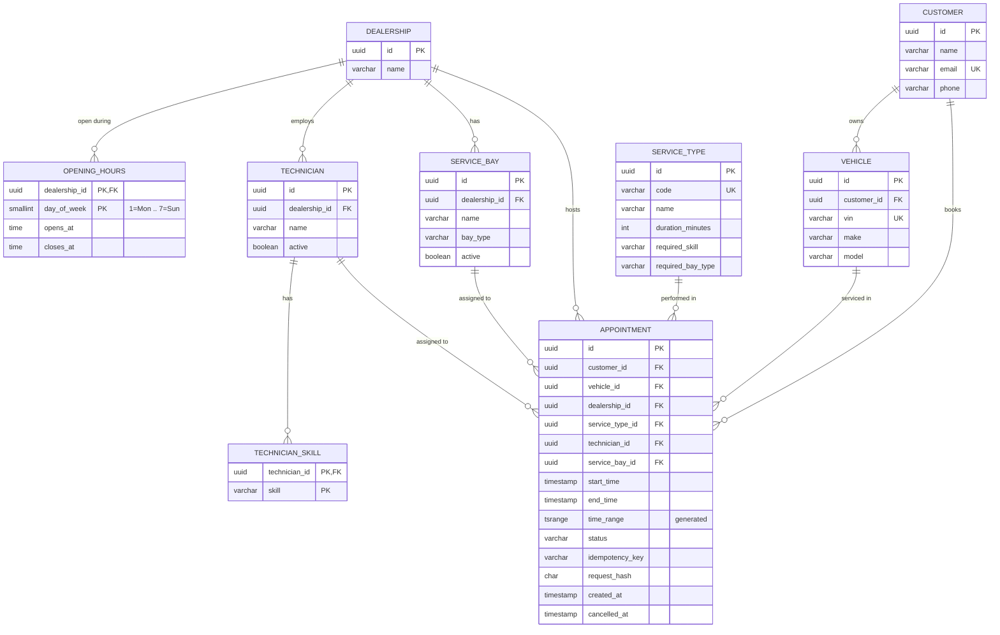

# 03: Data model

## 1. Entity-relationship diagram



## 2. Design rules

- **All date-times are `timestamp` (without time zone)** holding Vietnam local time, mapped to `java.time.LocalDateTime`. Opening hours are `time`, mapped to `LocalTime`. See ADR-003.
- **SQL never reads the clock.** No `now()`, `CURRENT_TIMESTAMP`, or column defaults based on time. The application passes every time value from its injected `Clock`, so tests can control time.
- **Enums are stored as `varchar`** with the Java enum name (`@Enumerated(EnumType.STRING)`). Values: `Skill` = `GENERAL_MAINTENANCE`, `BRAKES`, `EV_SYSTEMS`. `BayType` = `GENERAL`, `EV`. `AppointmentStatus` = `CONFIRMED`, `CANCELLED`.
- **`day_of_week` uses ISO numbering** (1 = Monday … 7 = Sunday), the same as `java.time.DayOfWeek.getValue()`.
- **IDs are UUIDs** generated by the application (`UUID.randomUUID()`), so fixture data can use fixed IDs.
- **The database guards every invariant it can**, so a bug in application code cannot corrupt the schedule.

## 3. Appointment table (the core)

```sql
CREATE TABLE appointment (
    id               uuid         PRIMARY KEY,
    customer_id      uuid         NOT NULL,
    vehicle_id       uuid         NOT NULL,
    dealership_id    uuid         NOT NULL REFERENCES dealership (id),
    service_type_id  uuid         NOT NULL REFERENCES service_type (id),
    technician_id    uuid         NOT NULL,
    service_bay_id   uuid         NOT NULL,
    start_time       timestamp    NOT NULL,
    end_time         timestamp    NOT NULL,
    time_range       tsrange      GENERATED ALWAYS AS (tsrange(start_time, end_time, '[)')) STORED,
    status           varchar(20)  NOT NULL,
    idempotency_key  varchar(100) NOT NULL,
    request_hash     char(64)     NOT NULL,
    created_at       timestamp    NOT NULL,
    cancelled_at     timestamp,

    CONSTRAINT ck_appointment_time_order   CHECK (end_time > start_time),
    CONSTRAINT ck_appointment_status       CHECK (status IN ('CONFIRMED', 'CANCELLED')),
    CONSTRAINT ck_appointment_cancelled_at CHECK ((status = 'CANCELLED') = (cancelled_at IS NOT NULL)),

    -- Same-dealership and ownership rules enforced by composite foreign keys
    CONSTRAINT fk_appointment_technician FOREIGN KEY (technician_id, dealership_id)
        REFERENCES technician (id, dealership_id),
    CONSTRAINT fk_appointment_bay        FOREIGN KEY (service_bay_id, dealership_id)
        REFERENCES service_bay (id, dealership_id),
    CONSTRAINT fk_appointment_vehicle    FOREIGN KEY (vehicle_id, customer_id)
        REFERENCES vehicle (id, customer_id),

    CONSTRAINT uq_appointment_idempotency UNIQUE (customer_id, idempotency_key),

    -- No double-booking (ADR-002)
    CONSTRAINT ex_appointment_technician_overlap
        EXCLUDE USING gist (technician_id WITH =, time_range WITH &&) WHERE (status = 'CONFIRMED'),
    CONSTRAINT ex_appointment_bay_overlap
        EXCLUDE USING gist (service_bay_id WITH =, time_range WITH &&) WHERE (status = 'CONFIRMED'),
    CONSTRAINT ex_appointment_vehicle_overlap
        EXCLUDE USING gist (vehicle_id WITH =, time_range WITH &&) WHERE (status = 'CONFIRMED')
);
```

Notes:

- `btree_gist` must be enabled (`CREATE EXTENSION IF NOT EXISTS btree_gist;`) so `uuid WITH =` can be used in a GiST index.
- `time_range` is **not mapped** in the JPA entity. Hibernate never writes it; PostgreSQL computes it. Queries that need it use native SQL.
- `'[)'` makes ranges half-open (GR-02): `[09:00,10:00)` and `[10:00,11:00)` do not overlap.
- Constraint names are part of the design. Application code reads them to decide how to react (04 §4), so they must not be renamed.
- The composite foreign keys require `UNIQUE (id, dealership_id)` on `technician` and `service_bay`, and `UNIQUE (id, customer_id)` on `vehicle`.

## 4. Other tables

| Table | Key columns and constraints |
|---|---|
| `dealership` | `id` PK, `name varchar(200) NOT NULL` |
| `opening_hours` | PK (`dealership_id`, `day_of_week`); `CHECK (day_of_week BETWEEN 1 AND 7)`; `CHECK (closes_at > opens_at)`. A missing row means closed |
| `service_type` | `code` UNIQUE; `CHECK (duration_minutes > 0 AND duration_minutes % 15 = 0)` keeps every end time on the 15-minute grid |
| `technician` | FK `dealership_id`; `active boolean NOT NULL`; `UNIQUE (id, dealership_id)` |
| `technician_skill` | PK (`technician_id`, `skill`) |
| `service_bay` | FK `dealership_id`; `bay_type`; `active`; `UNIQUE (id, dealership_id)` |
| `customer` | `email` UNIQUE; `phone` nullable |
| `vehicle` | FK `customer_id`; `vin varchar(17)` UNIQUE; `UNIQUE (id, customer_id)` |

## 5. Indexes

| Index | Serves |
|---|---|
| The three exclusion constraints (GiST) | Overlap checks for allocation, the vehicle pre-check, and constraint enforcement |
| `ix_appointment_dealership_start (dealership_id, start_time)` | Availability: loading a day's or week's appointments |
| `ix_appointment_customer_start (customer_id, start_time, id)` | US-08 list, sorted and paged |
| `ix_technician_dealership (dealership_id) WHERE active` | Candidate technicians |
| `ix_service_bay_dealership_type (dealership_id, bay_type) WHERE active` | Candidate bays |

## 6. Migrations and fixture data

| File | Contents | Loaded when |
|---|---|---|
| `db/migration/V1__reference_tables.sql` | Extension, all tables except `appointment` | Always |
| `db/migration/V2__appointment.sql` | `appointment`, constraints, indexes | Always |
| `db/fixture/R__fixture_data.sql` | The fixture dataset from `00-conventions.md`, using `INSERT … ON CONFLICT DO NOTHING` | `dev` profile only (Flyway `locations` add `classpath:db/fixture`) |

- **One source of fixture data.** Integration tests run only the `db/migration` scripts, then before each test a helper truncates all tables and executes the **same** `R__fixture_data.sql` file. The dev seed and the test fixture can never drift apart (AC-E01.4, AC-E01.5).
- Hibernate runs with `ddl-auto=validate`. The schema is changed only by new versioned migrations; applied migrations are never edited.

## 7. Entity mapping notes for the coding model

- `Appointment` has `@ManyToOne(fetch = LAZY)` references to customer, vehicle, dealership, service type, technician, and bay. Read queries use an `@EntityGraph` that loads them all, to avoid N+1 queries in lists.
- Do **not** add `@Version` to `Appointment`. Cancellation uses a conditional update (04 §6).
- Inserts use `saveAndFlush` so constraint violations are raised inside the attempt transaction (04 §4).
