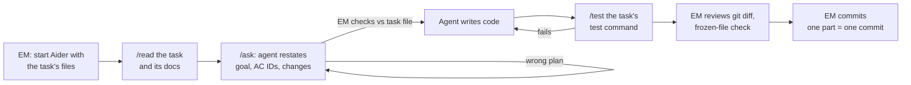

# Implementation tasks

**Status:** Ready · **Version:** 0.2 · **Date:** 2026-10-10 (switched to Aider + qwen2.5-coder:14b; large tasks split)
**Baseline:** user stories v0.4, system design v0.2 (both approved)

Tasks are sized for **qwen2.5-coder:14b in Aider with a 16k context**: one task part edits a handful of small files, reads at most about 5k tokens of documents, and ends with a single test command.

## One-time setup (EM)

1. Install Aider: `python -m pip install aider-install`, then `aider-install`.
2. Point Aider at Ollama: `setx OLLAMA_API_BASE http://127.0.0.1:11434` (open a new terminal afterwards).
3. `ollama pull qwen2.5-coder:14b`.
4. The repo root already has `.aider.conf.yml` (model, whole-file edits, no auto-commits, `CONVENTIONS.md` always loaded) and `.aider.model.settings.yml` (16k context).
5. Add to `.gitignore`: `.aider.chat.history.md`, `.aider.input.history`, `.aider.tags.cache.v*/`. Keep a copy of the chat history before deleting it: it is evidence for the AI narrative.
6. Delete the old `.clinerules` file.

## Workflow per task part



### 1. Start a fresh session

Start Aider once per task part, so earlier work never fills the context. Pass the files the task's **Files** table lists as editable (Aider creates missing ones):

```powershell
aider src/main/java/com/keyloop/scheduler/availability/AvailabilityService.java src/main/java/com/keyloop/scheduler/availability/AvailabilityController.java
```

Then load the task and its "Read first" files **read-only**:

```text
/read-only docs/tasks/T09-us02-daily-availability.md docs/user-stories/US-02-check-availability.md
```

Aider can only edit files added as editable. Docs and frozen tests loaded with `/read-only` cannot be changed, which enforces the contract mechanically.

### 2. Plan, then code

```text
/ask We are doing part B of the task file. Restate the goal, list the AC IDs covered, and describe the change you will make to each editable file. Do not write code yet.
```

Check the answer against the task file and its "Watch for" list. Correct it in chat, then:

```text
Implement part B as planned.
```

### 3. Test

Use the task's test command through `/test`. On failure, Aider shows the output to the model, which then attempts a fix:

```text
/test .\gradlew.bat test --tests "com.keyloop.scheduler.acceptance.DailyAvailabilityAcceptanceTest" --console=plain
```

If the model fails the same test three times in a row, stop. Start a fresh session, or split the step further, and log it.

### 4. Review (EM)

- `git diff --stat`: only the files the task names have changed.
- **Frozen-file check.** For a part B task this must print nothing:

  ```bash
  git status --porcelain -- docs CONVENTIONS.md src/test/java/com/keyloop/scheduler/acceptance
  ```

- Confirm each point under "Watch for" in the code.
- At the end of each phase, run `.\gradlew.bat build`.

### 5. Commit (EM)

One task part per commit:

```text
feat(US-03): auto-assign technician and bay [AC-03.1..03.10]

AI-Assisted: qwen2.5-coder:14b via Aider
Reviewed-by: EM
```

Use `test(US-03): acceptance tests (frozen)` for part A, and `build(...)` / `chore(...)` for foundation tasks.

### 6. Log what happened

Add a line to [`docs/ai-collaboration-log.md`](../ai-collaboration-log.md) whenever the agent did something wrong, surprising, or notably good.

## Test-first: parts A and B

Every story task has two parts, run as **separate** Aider sessions:

- **Part A: acceptance tests.** The agent writes one test per AC from the story file. They compile but fail (red). The EM reviews each test against its AC line by line, fixes any mismatch, then adds `// FROZEN: approved by EM <date>` as the first line of the file and commits. The tests are now the contract.
- **Part B: implementation.** A fresh session, with the frozen tests loaded read-only, implements until the frozen tests pass, without changing them.

Splitting the parts means the agent that writes the code never decides what "correct" means.

## Task index

| ID | Task | Story | Parts | Phase |
|---|---|---|---|---|
| [T00](T00-project-skeleton.md) | Generate the project skeleton (EM, no agent) | E-01 | n/a | 0 Foundation |
| [T01](T01-build-setup.md) | Kotlin DSL, version catalog, lean test containers | E-01 | steps 1, 2 | 0 |
| [T02](T02-schema.md) | Database schema migrations | E-01 | single | 0 |
| [T03](T03-test-foundation.md) | Fixture data, clock, test base classes | E-01 | sessions 1, 2 | 0 |
| [T04](T04-runtime-config.md) | Runtime configuration, Dockerfile, Compose | E-01 | single | 0 |
| [T05](T05-errors-and-request-id.md) | Error model, date-time parsing, request ID | E-02 (partly) | sessions 1, 2 | 0 |
| [T06](T06-catalog-and-customer-entities.md) | Catalog and customer entities | US-01 prep | single | 1 Reference data |
| [T07](T07-us01-reference-data.md) | Browse dealerships and service types | US-01 | A, B | 1 |
| [T08](T08-availability-calculator.md) | Scheduling rules and availability calculator (pure) | US-02 prep | single | 2 Availability |
| [T09](T09-us02-daily-availability.md) | Daily availability | US-02 | A, B | 2 |
| [T10](T10-us09-weekly-availability.md) | Weekly availability | US-09 | A, B | 2 |
| [T11](T11-appointment-persistence.md) | Appointment entity, allocation queries, constraint helper | US-03 prep | single | 3 Booking |
| [T12](T12-us03-book.md) | Book an appointment | US-03 | A, B1, B2 | 3 |
| [T13](T13-us04-validation.md) | Booking validation order | US-04 | A, B | 3 |
| [T14](T14-us05-concurrency-idempotency.md) | Concurrency and idempotency | US-05 | A, B1, B2 | 3 |
| [T15](T15-us06-us07-view-cancel.md) | View and cancel | US-06, US-07 | A, B | 3 |
| [T16](T16-us08-list.md) | List my appointments | US-08 | A, B | 4 Hardening |
| [T17](T17-e02-observability.md) | Observability | E-02 | A, B | 4 |
| [T18](T18-e03-api-docs.md) | API documentation and demo harness | E-03 | single | 4 |
| [T19](T19-architecture-tests.md) | Architecture rule tests (Should) | design 02 §4 | single | 4 |

The README, AI Collaboration Narrative, and traceability matrix are written by the EM, not the agent.

## Suggested schedule

| Day | Tasks |
|---|---|
| Day 2 (Fri) | T00–T07 |
| Day 3 (Sat) | T08–T12 |
| Day 4 (Sun) | T13–T15 |
| Day 5 (Mon) | T16–T19, full build on a fresh clone |
| Day 6 (Tue) | README and AI narrative, traceability matrix, video, submit |

If the schedule slips, drop in this order: T19, US-08 (T16), the optional Compose observability profile.

## Traceability

Every acceptance test's `@DisplayName` starts with its AC ID. This lists which ACs have tests:

```bash
grep -rhoE '"AC-[A-Z0-9]+\.[0-9]+' src/test/java | sort -u
```
