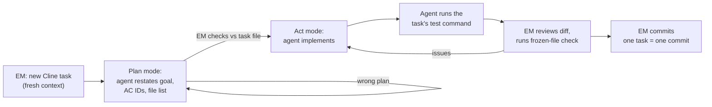

# Implementation tasks

**Status:** Ready · **Version:** 0.1 · **Date:** 2026-10-09
**Baseline:** user stories v0.4, system design v0.2 (both approved)

Tasks are sized for **qwen3-coder:30b in Cline with a 32k context**: one task touches a handful of files, reads at most about 6k tokens of documents, and ends with a single test command.

## Workflow per task



### 1. Start the task

Open a **new** Cline task for every task part, so earlier work never fills the context. Use this prompt:

```text
Task: docs/tasks/<FILE>.md, part <A|B>.
Read that task file first, then only the files listed under "Read first".
In Plan mode: restate the goal, list the AC IDs covered, and list every file you will create or change. Then wait for my approval.
```

### 2. Review the plan (EM)

Check the plan against the task file: correct AC IDs, no files outside the list, no extra dependencies, and the critical rules for that task (each task lists them under "Watch for"). Correct the plan in chat before switching to Act mode.

### 3. Review the result (EM)

- The task's test command passes. At the end of each phase, run `.\gradlew.bat build`.
- The diff contains only the files the task names.
- **Frozen-file check** (Git Bash or PowerShell):

  ```bash
  git status --porcelain -- docs .clinerules src/test/java/com/keyloop/scheduler/acceptance
  ```

  For a part B task this must print nothing, except files the task explicitly allows.
- Read the "Watch for" list in the task and confirm each point in the code.

### 4. Commit (EM)

One task part per commit:

```text
feat(US-03): auto-assign technician and bay [AC-03.1..03.10]

AI-Assisted: qwen3-coder:30b via Cline
Reviewed-by: EM
```

Use `test(US-03): acceptance tests (frozen)` for part A, and `chore(...)` / `build(...)` for foundation tasks.

### 5. Log what happened

Add a line to [`docs/ai-collaboration-log.md`](../ai-collaboration-log.md) whenever the agent did something wrong, surprising, or notably good. This log is the raw material for the README's AI Collaboration Narrative and the video.

## Test-first: parts A and B

Every story task has two parts, run as **separate** Cline tasks:

- **Part A: acceptance tests.** The agent writes one test per AC from the story file. They compile but fail (red). The EM reviews each test against its AC line by line, fixes any mismatch, then adds `// FROZEN: approved by EM <date>` as the first line of the file and commits. The tests are now the contract.
- **Part B: implementation.** A fresh agent session implements until the frozen tests pass, without changing them.

Splitting the parts means the agent that writes the code never decides what "correct" means.

## Task index

| ID | Task | Story | Parts | Phase |
|---|---|---|---|---|
| [T00](T00-project-skeleton.md) | Generate the project skeleton (EM, no agent) | E-01 | n/a | 0 Foundation |
| [T01](T01-build-setup.md) | Build setup and Spring Boot 4 check | E-01 | single | 0 |
| [T02](T02-schema.md) | Database schema migrations | E-01 | single | 0 |
| [T03](T03-test-foundation.md) | Fixture data, clock, test base classes | E-01 | single | 0 |
| [T04](T04-runtime-config.md) | Runtime configuration, Dockerfile, Compose | E-01 | single | 0 |
| [T05](T05-errors-and-request-id.md) | Error model, date-time parsing, request ID | E-02 (partly) | single | 0 |
| [T06](T06-catalog-and-customer-entities.md) | Catalog and customer entities | US-01 prep | single | 1 Reference data |
| [T07](T07-us01-reference-data.md) | Browse dealerships and service types | US-01 | A, B | 1 |
| [T08](T08-availability-calculator.md) | Scheduling rules and availability calculator (pure) | US-02 prep | single | 2 Availability |
| [T09](T09-us02-daily-availability.md) | Daily availability | US-02 | A, B | 2 |
| [T10](T10-us09-weekly-availability.md) | Weekly availability | US-09 | A, B | 2 |
| [T11](T11-appointment-persistence.md) | Appointment entity, allocation queries, constraint helper | US-03 prep | single | 3 Booking |
| [T12](T12-us03-book.md) | Book an appointment | US-03 | A, B | 3 |
| [T13](T13-us04-validation.md) | Booking validation order | US-04 | A, B | 3 |
| [T14](T14-us05-concurrency-idempotency.md) | Concurrency and idempotency | US-05 | A, B | 3 |
| [T15](T15-us06-us07-view-cancel.md) | View and cancel | US-06, US-07 | A, B | 3 |
| [T16](T16-us08-list.md) | List my appointments | US-08 | A, B | 4 Hardening |
| [T17](T17-e02-observability.md) | Observability | E-02 | A, B | 4 |
| [T18](T18-e03-api-docs.md) | API documentation and demo harness | E-03 | single | 4 |
| [T19](T19-architecture-tests.md) | Architecture rule tests (Should) | design 02 §4 | single | 4 |

The README, AI Collaboration Narrative, and traceability matrix are written by the EM, not the agent.

## Suggested schedule

| Day | Tasks |
|---|---|
| Day 2 (Fri) | T00–T07 |
| Day 3 (Sat) | T08–T12 |
| Day 4 (Sun) | T13–T15 |
| Day 5 (Mon) | T16–T19, full build on a fresh clone |
| Day 6 (Tue) | README and AI narrative, traceability matrix, video, submit |

If the schedule slips, drop in this order: T19, US-08 (T16), the optional Compose observability profile.

## Traceability

Every acceptance test's `@DisplayName` starts with its AC ID. This lists which ACs have tests:

```bash
grep -rhoE '"AC-[A-Z0-9]+\.[0-9]+' src/test/java | sort -u
```
